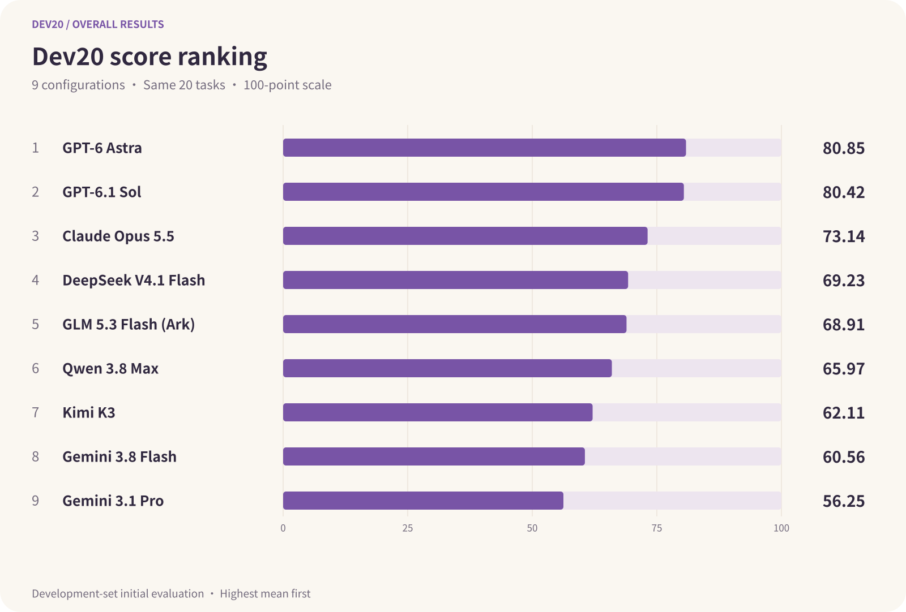
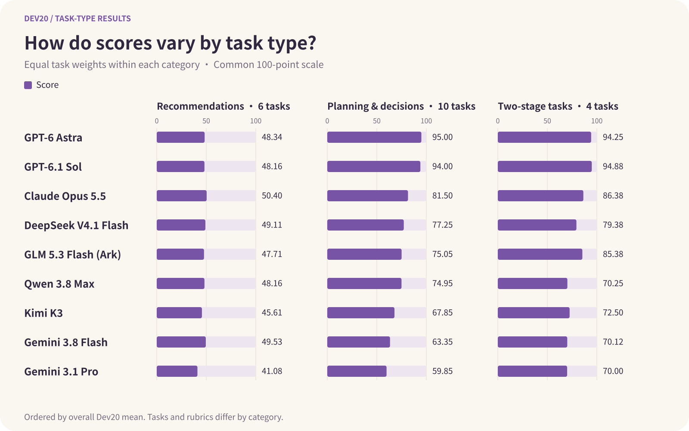

<h1 align="center">Graduate Admissions Agent Benchmark</h1>
<h3 align="center">Evaluating agents on postgraduate admission by recommendation in China</h3>

<p align="center">
  <a href="config/benchmark.json"></a>
  <a href="#quick-start"></a>
  <a href="LICENSE"></a>
  <a href="LICENSE-DATA"></a>
</p>

<p align="center"><strong>An open-source research project by Sprix AI at 屿智同行</strong></p>

<p align="center">
  Agents recommend graduate programs and plan applications from a student’s background.<br>
  When new facts arrive, can they revise their advice while retaining the constraints that still apply?
</p>

<p align="center">
  <a href="#current-results"><strong>Results</strong></a> ·
  <a href="#quick-start">Quick start</a> ·
  <a href="#how-it-works">How it works</a> ·
  <a href="docs/dataset.md">Dataset</a> ·
  <a href="docs/scoring.md">Scoring</a> ·
  <a href="docs/reproduction.md">Reproduction</a> ·
  <a href="#contributing-and-citation">Contributing</a>
</p>

<p align="center"><strong>English</strong> · <a href="README.zh-CN.md">简体中文</a></p>

This benchmark focuses on **postgraduate admission by recommendation** in China: eligible undergraduates are recommended by their universities and exempted from the national postgraduate entrance examination.

## Current results

Nine agent configurations completed the same 20 development-set tasks. All 180 answers have been initially reviewed and assigned numeric scores. Results are sorted by the 20-task mean, highest first; see the [full report](experiments/subset20-results-nine-final-20261010/README.md) for scoring details and revision history.

| Model | Dev20 mean | Scored |
| --- | ---: | ---: |
| GPT-6 Astra | 80.85 | 20/20 |
| GPT-6.1 Sol | 80.42 | 20/20 |
| Claude Opus 5.5 | 73.14 | 20/20 |
| DeepSeek V4.1 Flash | 69.23 | 20/20 |
| GLM 5.3 Flash (Ark) | 68.91 | 20/20 |
| Qwen 3.8 Max | 65.97 | 20/20 |
| Kimi K3 | 62.11 | 20/20 |
| Gemini 3.8 Flash | 60.56 | 20/20 |
| Gemini 3.1 Pro | 56.25 | 20/20 |



Scores are initial evaluations of this development subset, not final human-reviewed rankings.

### Scores by task type

Mean scores within each task type, out of 100. The categories contain 6, 10, and 4 tasks; each two-stage task counts once.

| Model | Recommendations (6) | Planning & decisions (10) | Two-stage tasks (4) |
| --- | ---: | ---: | ---: |
| GPT-6 Astra | 48.34 | 95.00 | 94.25 |
| GPT-6.1 Sol | 48.16 | 94.00 | 94.88 |
| Claude Opus 5.5 | 50.40 | 81.50 | 86.38 |
| DeepSeek V4.1 Flash | 49.11 | 77.25 | 79.38 |
| GLM 5.3 Flash (Ark) | 47.71 | 75.05 | 85.38 |
| Qwen 3.8 Max | 48.16 | 74.95 | 70.25 |
| Kimi K3 | 45.61 | 67.85 | 72.50 |
| Gemini 3.8 Flash | 49.53 | 63.35 | 70.12 |
| Gemini 3.1 Pro | 41.08 | 59.85 | 70.00 |



The chart shows confirmed scores. Tasks and rubrics differ across categories, so gaps do not isolate a single capability. This uses the same [results snapshot](experiments/subset20-results-nine-final-20261010/results.json) as the overall scores above.

[Full report, task-type comparisons, and per-task scores](experiments/subset20-results-nine-final-20261010/README.md) · [Unverified facts](experiments/subset20-results-nine-final-20261010/pending-review.md)

[Execution records, including Qwen](experiments/subset20-20261009-r2/README.md) · [Run package and checksums](release/dev20-20261009/r2/manifest.json)

Qwen continuations, Claude subscription recovery, GLM extraction correction, and HTTP 503 review recovery remain documented. The linked r2 run package still covers seven configurations; Claude and GLM raw records have not yet been added to that attachment.

## How it works

We evaluate complete native agent products, recording their models, tools, and authentication configurations. The first 20 tasks include 6 program recommendations, 10 planning and decision tasks, and 4 two-stage tasks. Candidate prompts are in Chinese.

1. **Provide a student background.** The agent considers academic rank, language scores, research experience, and application goals. Each task starts in an isolated session.
2. **Release new information.** Two-stage tasks introduce additional facts after the first answer, continuing in the same session to test how advice changes.
3. **Review independently.** A separate reviewer checks fit, factual support, and actionable advice against the task rubric. Candidates cannot access review materials.
4. **Calculate scores.** Code validates answer quotations and computes scores. Two stages count as one task; incomplete and unresolved items remain visible.


### Example: more projects, the same eligibility constraint

| Stage | Information supplied by the student |
| --- | --- |
| Initial | General engineering at Xi’an Jiaotong University; rank 19/123; CET-6 458; no formally declared major; interested in mechanical engineering or smart manufacturing. |
| Update | Additional mechanical innovation, provincial research, and smart lock projects; the registered program is still general engineering. |

The projects strengthen evidence of research fit, but do not establish undergraduate-major eligibility. Good advice uses this experience while checking formal program requirements and explaining the next steps.

See the [full task and evaluation criteria](docs/benchmark-guide.en.md#4-example-n16-02), [scoring method](docs/scoring.md), and [reproduction guide](docs/reproduction.md).

### Dataset

| Split | Tasks | Scope |
| --- | ---: | --- |
| Public development set | 75 | 61 single-stage and 14 two-stage tasks, across 24 anonymized student cases |
| Private test set | 125 | Held by the organizer |
| First experiment | 20 | Selected from the public development set; 24 response stages |

All 200 tasks are teacher-calibrated. The public and private sets share student cases, so they do not form an independent student holdout. See the [dataset](docs/dataset.md) and [20-task selection](docs/public-subset-20.md).

Hugging Face hosts task prompts, task types, stage structures, and scoring materials. GitHub hosts execution code, protocols, guides, and each experiment's results and run-record index; large run archives are distributed as Release attachments when published. The first experiment uses one 20-task subset. Private test prompts and rubrics are excluded. See [publication details](docs/experiment-publication.md) for the status of each artifact and [historical workflows](docs/historical-workflows.md) for the earlier 79-task source pool.

## Quick start

Use Python 3.10+ and macOS for native CLI execution (Kimi requires Python 3.11+). Install and sign in to the official client you want to evaluate; no additional Python packages are required.

```sh
python3 -m benchmark setup --agent gpt-6-1-sol
python3 -m benchmark cli-check --agent gpt-6-1-sol
python3 -m benchmark cli-batch --suite dev \
  --agent gpt-6-1-sol --task N02-01 \
  --out ./runs/codex-one-task --execute
```

Run from the repository root. Execution uses your account allowance; omit `--execute` to preview. After the single-task trial, follow the [full guide](docs/quick-start.en.md) to run the fixed 20 tasks, resume a batch, score answers, and generate a report. See [native CLI configuration](docs/native-cli.md) for other agents.

## Documentation

The illustrated guide and execution instructions are available in English. Other detailed guides below are currently in Chinese.

| Topic | Guide |
| --- | --- |
| Task types, process, and example | [Illustrated benchmark guide](docs/benchmark-guide.en.md) |
| Dataset and public/private scope | [Dataset](docs/dataset.md) |
| Running, scoring, and reports | [Full getting-started guide](docs/quick-start.en.md) |
| Client configuration, batches, packets, isolation | [Native CLI](docs/native-cli.md) |
| Rubrics, evidence, disputes | [Scoring](docs/scoring.md) · [Review protocol](docs/review-protocol.md) |
| Experiment versions and statistics | [Study protocol](docs/study.md) · [Reproduction](docs/reproduction.md) |
| Local packaging and release boundaries | [Publication](docs/publication.md) · [Release scope](docs/release-scope.md) |

## Team

This project is initiated by **Sprix AI at 屿智同行**. Sprix AI works on agent discovery, task matching, and collaboration; this benchmark contributes evaluation methods and evidence from realistic advising scenarios.

- **Yonghao Zhang** — CEO of 屿智同行; Master's degree in Computer Science from Tsinghua University.
- **Yichen Wang** — CTO of 屿智同行; Sprix AI project lead.

## Contributing and citation

[75-task execution records](experiments/dev75-20261010/README.md) · [Run and submit the remaining GPT tasks](docs/community-runs.md) (Chinese; macOS).

We welcome issues and pull requests about postgraduate admission advising tasks, evaluation tools, and documentation.

- Use anonymized cases and only the student facts disclosed in the task. Keep private tests, personal source records, credentials, and local configuration out of public contributions. Disclose shared cases across splits; do not describe them as an independent student holdout.
- Keep rubrics and reference answers on the reviewer side. Version task, rubric, and manifest changes, and preserve published experiment snapshots. See the [dataset guide](docs/dataset.md) and [review protocol](docs/review-protocol.md).
- Preserve existing interfaces and the standard-library implementation. Changes to execution, scoring, transport, or versioning need focused checks with synthetic data; do not call real models in tests or describe simulations as model acceptance.
- Explain the change and its verification in the pull request. Follow the [release scope](docs/release-scope.md) before publishing reviewed, sanitized answers or trajectories. Keep release versions consistent across `config/benchmark.json`, `benchmark/reproduction.py`, and `CITATION.cff`.

Code is licensed under [MIT](LICENSE); data under [CC BY 4.0](LICENSE-DATA). When citing results, credit “保研 Agent Benchmark contributors” and report the version, task selection, product configuration, and release fingerprint. [CITATION.cff](CITATION.cff) provides machine-readable citation metadata; no paper or DOI has been issued.
