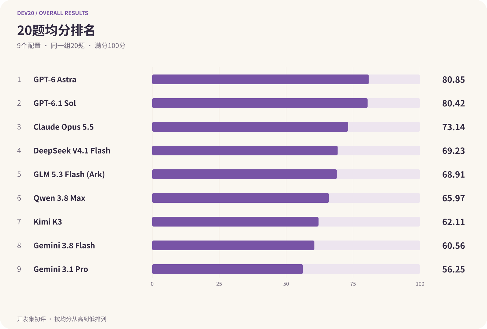
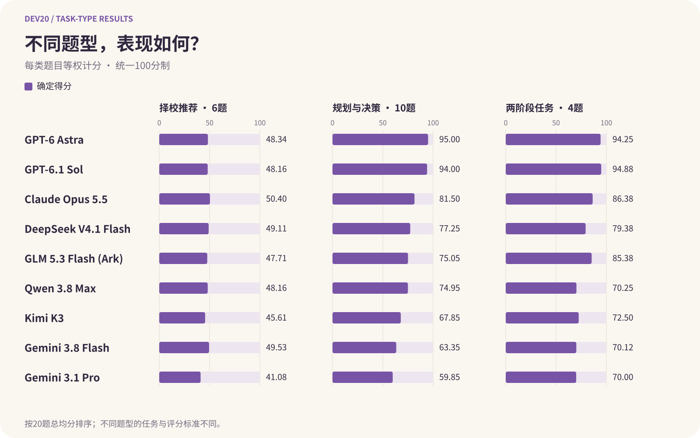
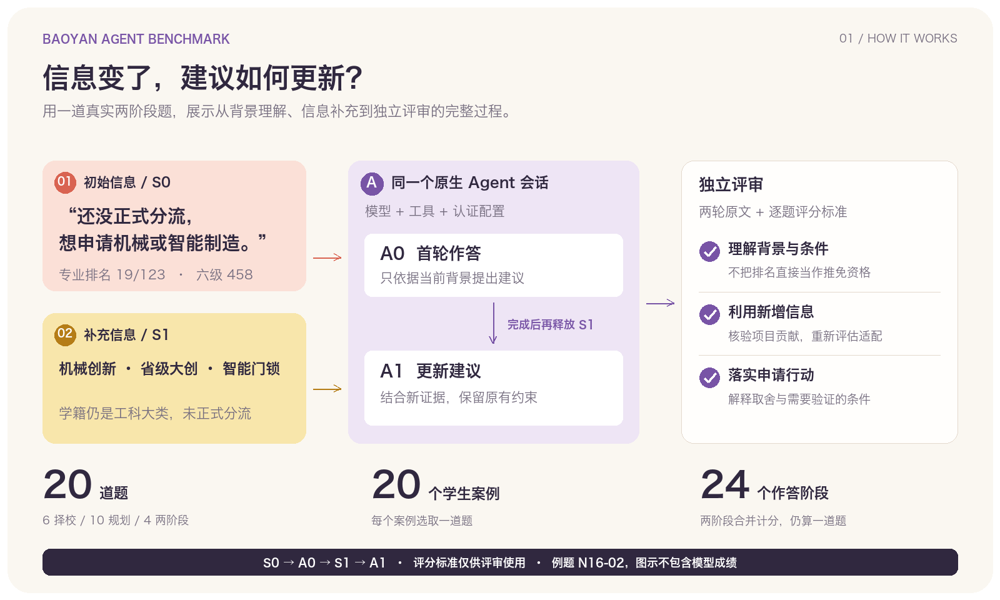

<h1 align="center">保研 Agent Benchmark</h1>
<h3 align="center">面向保研咨询与申请规划的 Agent 评测</h3>

<p align="center">
  <a href="config/benchmark.json"></a>
  <a href="#快速开始"></a>
  <a href="LICENSE"></a>
  <a href="LICENSE-DATA"></a>
</p>

<p align="center"><strong>由屿智同行 Sprix AI 发起的开源研究项目</strong></p>

<p align="center">
  让 Agent 根据学生背景推荐院校、制定申请计划，<br>
  并在补充信息后重新判断：哪些建议需要修改，哪些申请条件仍然成立。
</p>

<p align="center">
  <a href="#当前结果"><strong>评测结果</strong></a> ·
  <a href="#快速开始">快速开始</a> ·
  <a href="#如何评测">评测流程</a> ·
  <a href="docs/dataset.md">数据集</a> ·
  <a href="docs/scoring.md">评分规则</a> ·
  <a href="docs/reproduction.md">复现指南</a> ·
  <a href="#贡献与引用">参与贡献</a>
</p>

<p align="center"><a href="README.md">English</a> · <strong>简体中文</strong></p>

## 当前结果

9个Agent配置在同一组20道开发集题目上完成评测，共180份答卷，均已完成初评并获得确定分数。以下按20题平均分从高到低排列，评分细节与修订记录见[完整报告](experiments/subset20-results-nine-final-20261010/README.zh-CN.md)。

| 模型 | 20题均分 | 已评分 |
| --- | ---: | ---: |
| GPT-6 Astra | 80.85 | 20/20 |
| GPT-6.1 Sol | 80.42 | 20/20 |
| Claude Opus 5.5 | 73.14 | 20/20 |
| DeepSeek V4.1 Flash | 69.23 | 20/20 |
| GLM 5.3 Flash (Ark) | 68.91 | 20/20 |
| Qwen 3.8 Max | 65.97 | 20/20 |
| Kimi K3 | 62.11 | 20/20 |
| Gemini 3.8 Flash | 60.56 | 20/20 |
| Gemini 3.1 Pro | 56.25 | 20/20 |



结果仅覆盖本次开发集子集，仍属初评，不能视为已完成人工终审的排名。

### 按题型得分

以下为每类题目的平均得分，满分100分；三类分别包含6、10、4道题，两阶段任务合并计为一道题。

| 模型 | 择校推荐（6题） | 规划与决策（10题） | 两阶段任务（4题） |
| --- | ---: | ---: | ---: |
| GPT-6 Astra | 48.34 | 95.00 | 94.25 |
| GPT-6.1 Sol | 48.16 | 94.00 | 94.88 |
| Claude Opus 5.5 | 50.40 | 81.50 | 86.38 |
| DeepSeek V4.1 Flash | 49.11 | 77.25 | 79.38 |
| GLM 5.3 Flash (Ark) | 47.71 | 75.05 | 85.38 |
| Qwen 3.8 Max | 48.16 | 74.95 | 70.25 |
| Kimi K3 | 45.61 | 67.85 | 72.50 |
| Gemini 3.8 Flash | 49.53 | 63.35 | 70.12 |
| Gemini 3.1 Pro | 41.08 | 59.85 | 70.00 |



图表展示确定得分；不同题型使用不同任务与评分标准，不能把分差直接视为单一能力差距。数据与上方总分使用同一份[结果快照](experiments/subset20-results-nine-final-20261010/results.json)。

[完整报告、题型对比和逐题分数](experiments/subset20-results-nine-final-20261010/README.zh-CN.md) · [未证实事实说明](experiments/subset20-results-nine-final-20261010/pending-review.md)

[执行记录（含千问）](experiments/subset20-20261009-r2/README.md) · [运行包与校验值](release/dev20-20261009/r2/manifest.json)

千问续作、Claude订阅恢复、GLM答卷提取修正及评分服务503补评均保留记录。上方r2运行包仍为七配置版本；Claude与GLM完整原始记录尚未打入该附件。

## 如何评测

评测对象是完整的原生 Agent 产品，记录其模型、工具和认证配置。首批20题包括6道择校推荐、10道规划与决策、4道两阶段题。

1. **给出学生背景。** Agent 根据排名、英语成绩、科研经历和申请目标提出建议；每道题使用独立会话。
2. **补充信息。** 两阶段题在首轮作答后释放新事实，在同一会话内继续，考察建议如何更新。
3. **独立评审。** 评审者依据逐题评分标准检查适配性、事实依据和可执行性；被测 Agent 看不到评分材料。
4. **计算成绩。** 程序校验答卷引句并计算分数。两阶段合为一道题，未完成与待核项在结果中单列。



### 例题：项目经历增加，专业限制还在吗？

| 阶段 | 学生提供的信息 |
| --- | --- |
| 首轮 | 西安交大工科大类，排名19/123，六级458，未正式分流，希望申请机械或智能制造。 |
| 补充 | 增加机械创新、省级大创和智能门锁项目经历，但学籍专业仍是工科大类。 |

新增项目能支持研究方向适配，却不能直接证明满足目标项目的本科专业要求。好的建议应利用这些经历，同时核实专业认定与申请条件，并说明下一步如何行动。

查看[完整题面与评分标准](docs/benchmark-guide.md#4-完整例题n16-02) · [评分方法](docs/scoring.md) · [复现指南](docs/reproduction.md)。

### 数据集

| 范围 | 题量 | 内容 |
| --- | ---: | --- |
| 公开开发集 | 75 | 61道单阶段题、14道两阶段题，覆盖24个匿名学生案例 |
| 私有测试集 | 125 | 由组织者持有 |
| 首批实验 | 20 | 从公开开发集选取，共24个作答阶段 |

200道题均已完成教师校准。公开集与私有集共享学生案例，不构成独立学生留出集。详见[数据说明](docs/dataset.md)和[20题选题说明](docs/public-subset-20.md)。

Hugging Face 放题目、任务类型、阶段结构和评分资料；GitHub 放执行代码、协议、使用说明及每次实验的结果与运行记录索引，大体积运行包在发布后通过 Release 附件提供。首次实验是一个包含20道题的子集，私有测试题面和细则不公开。各项材料的实际发布状态见[发布分工](docs/experiment-publication.md)，早期79题源池及兼容入口见[历史版本说明](docs/historical-workflows.md)。

## 快速开始

原生 CLI 自动执行需要 macOS、Python 3.10+（Kimi 需要 3.11+），并安装、登录要测的官方客户端。无需额外安装 Python 依赖。

```sh
python3 -m benchmark setup --agent gpt-6-1-sol
python3 -m benchmark cli-check --agent gpt-6-1-sol
python3 -m benchmark cli-batch --suite dev \
  --agent gpt-6-1-sol --task N02-01 \
  --out ./runs/codex-one-task --execute
```

在仓库根目录执行，运行会使用你的账号额度；去掉 `--execute` 可先预览。单题跑通后，按[完整指南](docs/quick-start.md)运行固定20题、恢复批次、独立评分并生成报告。其他 Agent 的配置见[客户端指南](docs/native-cli.md)。

## 文档导航

| 想了解什么 | 文档 |
| --- | --- |
| 用图理解任务、流程和案例 | [图解与完整例题](docs/benchmark-guide.md) |
| 题库结构、公开与私有范围 | [数据说明](docs/dataset.md) |
| 运行、评分与生成报告 | [完整使用指南](docs/quick-start.md) |
| 客户端配置、批跑、跨电脑答题与隔离 | [原生CLI指南](docs/native-cli.md) |
| 逐题评分、证据与争议处理 | [评分规则](docs/scoring.md) · [评审流程](docs/review-protocol.md) |
| 实验版本、统计与结果复核 | [实验协议](docs/study.md) · [复现指南](docs/reproduction.md) |
| 本地打包与发布边界 | [发布准备](docs/publication.md) · [发布范围](docs/release-scope.md) |

## 团队

本项目由**屿智同行 Sprix AI** 发起。Sprix AI 专注于 Agent 发现、任务匹配与协作，本项目为真实咨询场景提供评测方法与实验依据。

- **Yonghao Zhang** — 屿智同行 CEO；清华大学计算机科学硕士。
- **Yichen Wang** — 屿智同行 CTO；Sprix AI 项目负责人。

## 贡献与引用

[75题执行记录](experiments/dev75-20261010/README.md) · [参与运行与提交](docs/community-runs.md)。

欢迎围绕保研任务、评测工具和文档提交 Issue 或 Pull Request。

- 使用匿名案例，只采用题设已披露的学生事实；不提交私有测试题、个人原始资料、凭据或本机配置。同一案例跨集合时说明重叠，不宣称为独立学生留出集。
- 评分细则与参考答案只供评审使用。修改题目、评分规则及清单时更新版本和指纹，保留已发布实验快照。具体格式与审核要求见[数据说明](docs/dataset.md)和[评审流程](docs/review-protocol.md)。
- 保持现有接口及标准库实现。改动执行、评分、传输或版本逻辑时，用合成数据做针对性检查，不在测试中调用真实模型，不把模拟结果写成真实模型验收。
- PR 说明问题、改动及验证范围。公开脱敏答卷或轨迹前按[发布范围](docs/release-scope.md)完成审核；发布版本在 `config/benchmark.json`、`benchmark/reproduction.py` 和 `CITATION.cff` 中保持一致。

代码采用 [MIT](LICENSE)，数据采用 [CC BY 4.0](LICENSE-DATA)。引用时署名“保研 Agent Benchmark contributors”，注明版本、实验题集、产品配置和发布指纹。[CITATION.cff](CITATION.cff) 提供机器可读的引用信息；目前没有正式论文或 DOI。
