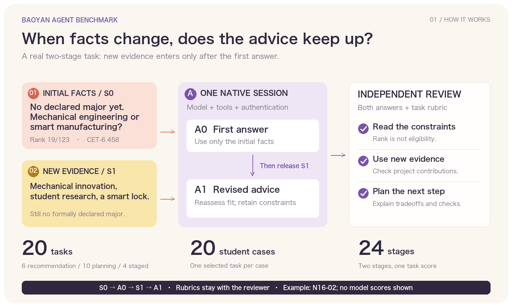
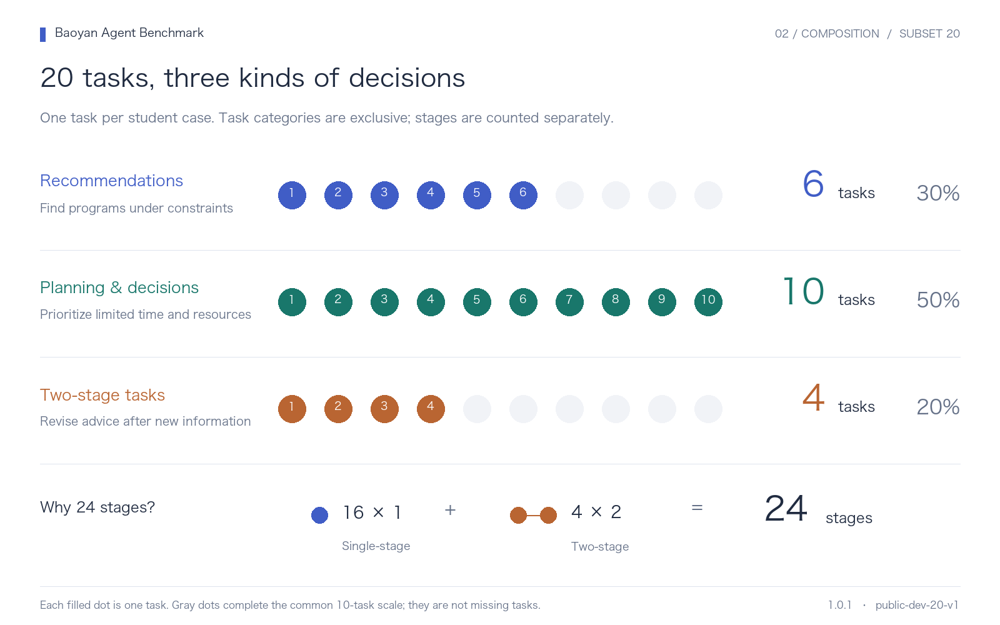
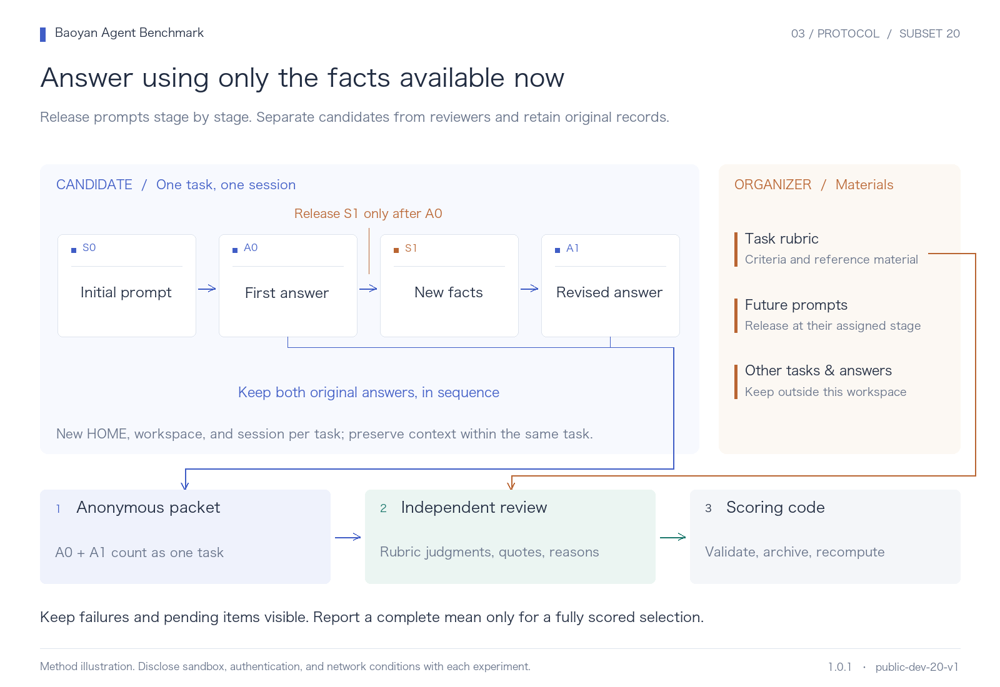
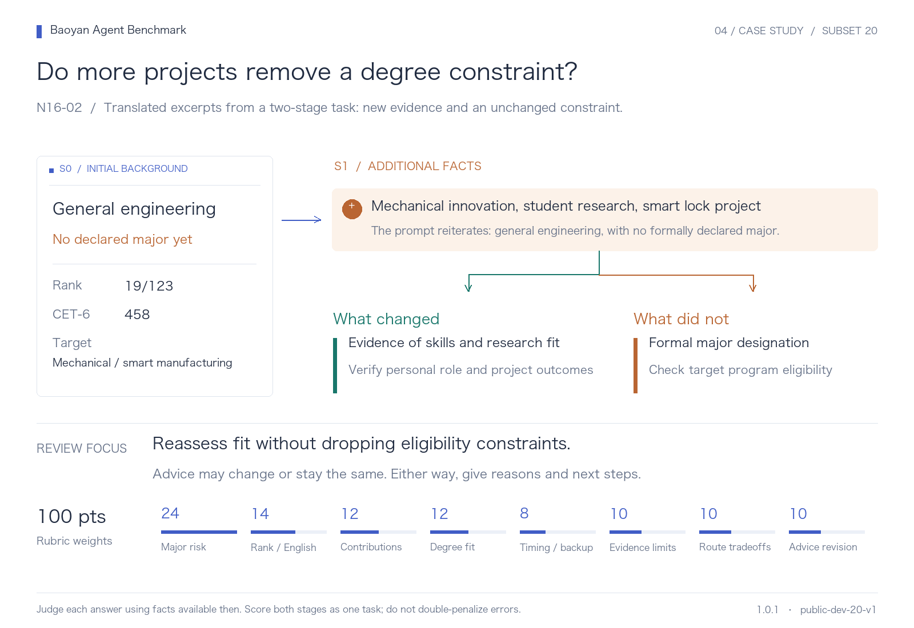

# Baoyan Agent Benchmark: illustrated guide

[简体中文](benchmark-guide.md) · [Execution instructions](quick-start.en.md)

Four figures introduce the task set, evaluation process, and a two-stage example. Version: **1.0.1 / public-dev-20-v1**. Evaluation uses the original Chinese prompts and rubrics; English excerpts are translations.

## 1. What is evaluated?



We compare complete native agent products, including their models, tools, and authentication configurations. Tasks ask agents to interpret backgrounds, assess program fit, and propose concrete actions. Two-stage tasks test whether advice responds to newly released facts while retaining constraints that still apply.

## 2. What is in the first selection?



| Task type | Tasks | Stages |
| --- | ---: | ---: |
| Recommendations | 6 | 6 |
| Planning and decisions | 10 | 10 |
| Two-stage tasks | 4 | 8 |
| Total | 20 | 24 |

The first experiment includes 20 tasks from 20 student cases. Each filled dot represents one task. See the [selection notes](public-subset-20.md) for how the tasks were chosen.

## 3. How are tasks run and scored?



Freeze the selection, task and rubric versions, configuration, and budget. Release only the current prompt to the candidate. Keep original answers and tool records. Review each task independently with its rubric, then validate quotations and recompute scores in code. A two-stage task receives one task score. Missing, failed, and pending items are marked in the results.

Native execution currently uses a macOS process sandbox. Report authentication, tools, network restrictions, execution differences, and retries with each experiment. See the [six-step execution guide](quick-start.en.md).

## 4. Example: N16-02



**Task time: the 2026 recommendation admission cycle.** 

**S0 — initial background**

> I am in the general engineering program at Xi'an Jiaotong University, ranked 19/123, with a CET-6 score of 458. I have not formally declared a major. I have done mechanical engineering projects and want to apply for mechanical engineering or smart manufacturing, but I do not know whether my undergraduate major designation will limit my options. Can you help me assess this?

Save the first answer before releasing the second stage.

**S1 — additional experience**

> I have also worked on mechanical innovation, a provincial student research project, and a smart lock system. But my registered program is still general engineering; I have not formally entered smart manufacturing. Given this information, how would you identify suitable programs for me?

New projects add evidence of capability and research fit. They do not change the student's formal major designation. Review checks whether the agent uses the new evidence while retaining program eligibility constraints. Advice may change or stay the same, but it needs reasons and actionable next steps. The figure's abbreviated rubric labels are explanatory; the [original rubric](../data/staged-dev/N16-02/rubric.json) governs scoring.

## Sources and regeneration

- Data: [first 20 tasks](../config/selections/public-dev-20-v1.json).
- [Figure manifest](figures/subset20-en-v1/manifest.json): sources and file checksums.
- Each figure is supplied as SVG and PNG; the bundled images need no rendering dependencies to read.


Generate SVG files with the standard library:

```sh
python3 scripts/render_benchmark_figures_en.py
```

With an existing Pillow installation and font, add `--png --font /path/to/font.ttc`. Each experiment keeps its own selection and source versions; a different task set needs its own figures and report.
