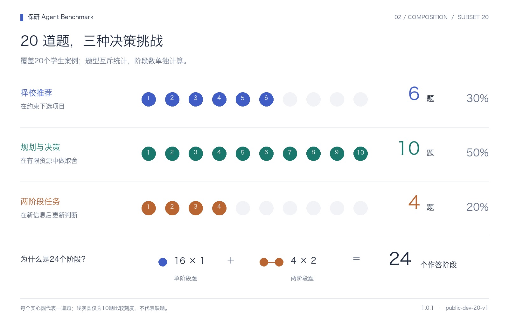
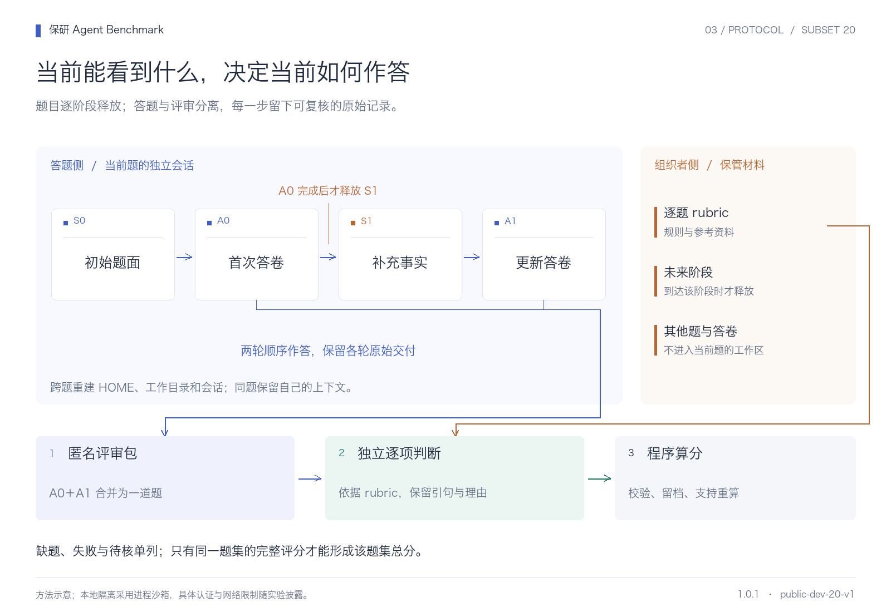
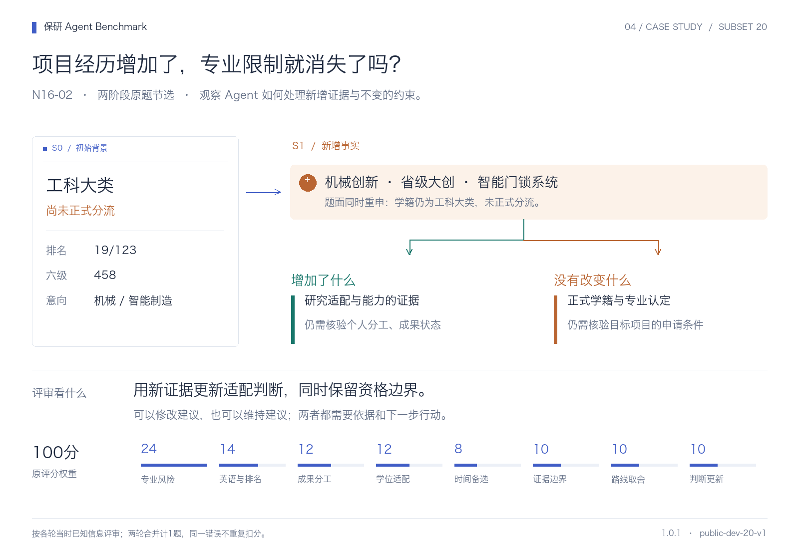

# 保研 Agent Benchmark 图解

用四张图了解评测范围、题库构成、执行方式和两阶段例题。版本：**1.0.1 / public-dev-20-v1**。

## 1. 测什么


我们比较原生 Agent 产品及其模型、工具和认证配置。题目要求理解学生背景与升学约束，进行项目选择、路线取舍和行动规划；两阶段题进一步考察新增信息后的判断更新。

20题从79道公开原题中按任务类型、学科和决策场景选取，详见[选题说明](public-subset-20.md)。

## 2. 题库怎样分布



| 范围 | 择校推荐 | 规划与决策 | 两阶段任务 | 题数 | 阶段数 |
| --- | ---: | ---: | ---: | ---: | ---: |
| 首批20题 | 6 | 10 | 4 | 20 | 24 |

首批实验包含20题，覆盖20个学生案例。图中每个实心圆代表一道题。

## 3. 如何执行和评分



1. **组织者冻结输入。** 固定题目选择、题面与rubric版本、产品配置、预算和协议。评分材料与来源映射由组织者保管。
2. **候选Agent只接收当前阶段。** 每道题创建独立工作目录、HOME和会话；两阶段题在首次答卷完成后才释放下一阶段，在该题自身会话内继续。
3. **保留原始交付与轨迹。** 以完整 `answer.md` 为评分正文，区分最终聊天回复、工具轨迹和实际交付文件，保留失败与重试来源。
4. **分离答题与评审。** 单份匿名评审包只含对应题目、rubric和原始答卷。两阶段答卷合并按一道题评审；评审逐项给出引句、理由与待核项。
5. **代码负责算分和校验。** 根据评审记录计算分数，标注未完成和待核项。

本机使用 macOS 进程沙箱及受限网络。各产品的认证、工具和运行配置随实验记录。

## 4. 完整例题：N16-02



**任务时点：2026年推免申请季。**

### 阶段 S0：先给出当前背景

> 我在西安交大读工科大类，排名19/123，六级458，还没正式分流。我做过机械相关项目，想申请机械或智能制造，但不知道本科的专业认定会不会限制选择。你能帮我判断吗？

保存首次答卷后，再提供第二阶段信息。

### 阶段 S1：补充经历，重新判断

> 我还做过机械创新、省级大创和智能门锁系统相关项目，但学籍上的专业仍是工科大类，没有正式分流成智能制造。考虑这些信息，你会怎么确定适合申请的项目？

### 观察点

新增工程项目可以丰富研究适配与贡献证据，但题目再次明确“未正式分流”。评审检查Agent是否同时处理两者：利用新增信息，并保留正式专业认定和目标项目申请条件的限制。建议可以调整，也可以维持；关键是给出依据及可执行的下一步。

### 原评分项与权重

两轮合并评分，总计100分。下表为评分项、权重和满分条件。

| 评分项 | 分值 | 满分条件（原文） |
| --- | ---: | --- |
| 尚未分流的专业风险 | 24 | 结合已知专业排名、人数及校内推免规则，针对“尚未分流的专业风险”形成具体判断；明确资格尚未确认时的验证对象和条件，不把成绩排名直接当作推免名额排序。 |
| 英语458与排名影响 | 14 | 结合已知专业排名、人数及校内推免规则，针对“英语458与排名影响”形成具体判断；明确资格尚未确认时的验证对象和条件，不把成绩排名直接当作推免名额排序。 |
| 工程科研成果分工 | 12 | 围绕学生实际项目、作者位次、个人分工或成果阶段，落实“工程科研成果分工”；至少给出与真实证据对应的整理、实验、验证或推进动作，不得将计划/在投说成录用发表。 |
| 机械与智能制造对应学位 | 12 | 围绕“机械与智能制造对应学位”给出学校/院系/学位或方向层面的适配判断，指出关键限制和可核验渠道；不得只泛称顶尖院校或保证录取。 |
| 申请时间与条件备选 | 8 | 就“申请时间与条件备选”给出与该学生已知背景相符的具体建议，说明优先级及可检验交付或判断依据；不以空泛口号代替行动。 |
| 证据和条件边界 | 10 | 能指出证据不足处并设置验证办法 |
| 比较与可解释取舍 | 10 | 解释多个路线的收益成本与转向条件 |
| 结合新证据重新评估建议 | 10 | 准确利用新增事实重新评估原建议：需要修改时说明具体变化和理由；无需修改时解释为何原判断仍成立，并给出相应的可执行行动 |

详细计分方法见[评分规则](scoring.md)。

## 5. 图表来源与复用

- 数据：[首批20题清单](../config/selections/public-dev-20-v1.json)。
- 图片附带SVG矢量版与PNG版：可直接用于README、数据卡和演示材料。
- [图表文件记录](figures/subset20-v1/manifest.json)保存来源与校验值。


## 6. 换题集时如何维护

每次实验分别保存题集、评分规则、产品配置和结果。

本页图表对应首批20题；更换题集时，新增对应版本的图表和报告。

重新生成SVG：

```sh
python3 scripts/render_benchmark_figures.py
```

使用已有Pillow和中文字体，可添加 `--png --font /path/to/CJK-font.ttc` 生成PNG。
