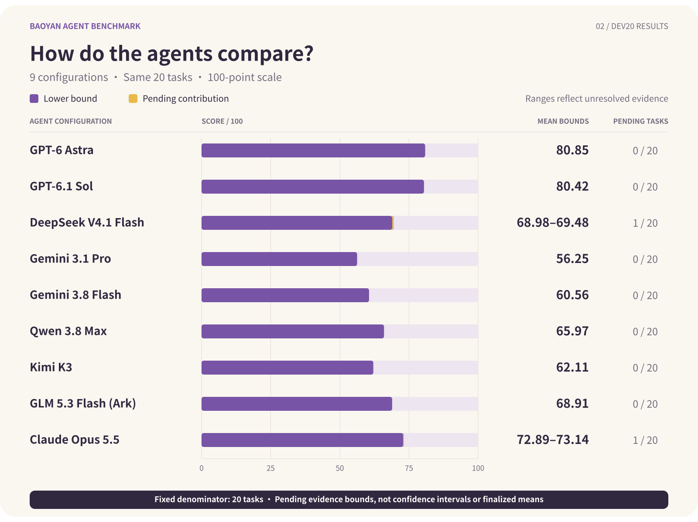
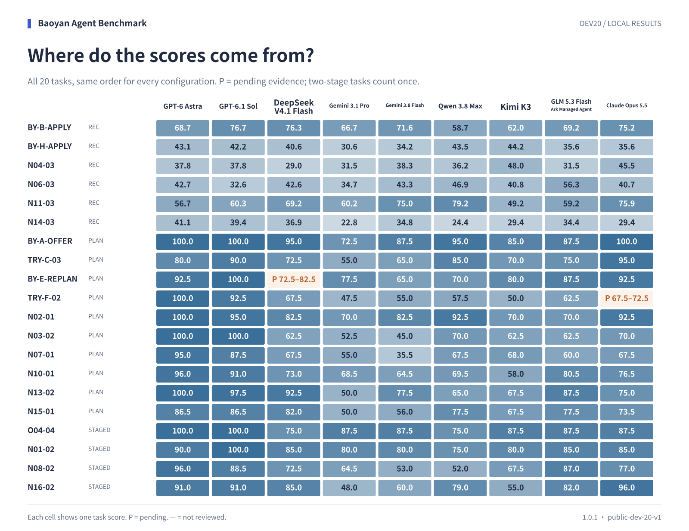

# 首批20题评测结果

**资格判断修正：** Gemini 3.8 Flash把特殊通道概括为排名普遍放宽的兜底渠道，按已确认适用性错误处理。N10-01-T1由待核改为半分12.5/25，该题64.5分、20题均分60.56。其余答卷成绩不变；个别专项名称不确定不再挂起已有明确错误的评分项。

[English](README.md)

更新时间：2026-10-10T01:13:33+08:00

本报告包含9个配置，其中9个已完成20题评审。以下为本地开发集初评结果。

分数范围按固定20题和待核项的可得分上下界计算，不是置信区间或已确定的均分。全部题目完成评分后才报告完整均分。

**评分复核范围：** 本次公开答卷、运行记录及初评结果。完整逐项评审材料与离线评分复核包暂未公开，因此目前无法仅凭公开材料独立重算全部评分。本页的校验记录反映组织者在本地完成的复算。

| 模型 | 20题均分范围 | 已评审 | 已评分 | 待核题 |
| --- | ---: | ---: | ---: | ---: |
| GPT-6 Astra | 80.85 | 20/20 | 20/20 | 0 |
| GPT-6.1 Sol | 80.42 | 20/20 | 20/20 | 0 |
| DeepSeek V4.1 Flash | 68.98–69.48 | 20/20 | 19/20 | 1 |
| Gemini 3.1 Pro | 56.25 | 20/20 | 20/20 | 0 |
| Gemini 3.8 Flash | 60.56 | 20/20 | 20/20 | 0 |
| Qwen 3.8 Max | 65.97 | 20/20 | 20/20 | 0 |
| Kimi K3 | 62.11 | 20/20 | 20/20 | 0 |
| GLM 5.3 Flash (Ark) | 68.91 | 20/20 | 20/20 | 0 |
| Claude Opus 5.5 | 72.89–73.14 | 20/20 | 19/20 | 1 |

执行快照：Qwen 3.8 Max已完成20/20份答卷，已评审20/20。其中6份答卷在超时后携带既有记录开启新会话并延长时限，属于补充执行，并非原生会话恢复；这些答卷已有6份完成评审。4份续作答卷已核对成功交付，但未保存可恢复的会话检查点。逐题执行方式、原失败与恢复来源见执行记录。

[执行记录与答卷指纹](execution-progress.json)

GLM 5.3 Flash (Ark)：执行快照中20/20题有完整答卷，0题执行失败。失败题不计零分；只有20题均有确定分数时才报告整套均分。

GLM 配置：GLM 5.3 Flash（火山方舟 Managed Agent），实际模型 `glm-5-3-flash-260828`，通过 arkcli 1.0.37 调用；不是豆包模型。云端隔离未独立审计。



## 按题型比较

| 模型 | 择校推荐（6题） | 规划与决策（10题） | 两阶段任务（4题） |
| --- | ---: | ---: | ---: |
| GPT-6 Astra | 48.34 | 95.00 | 94.25 |
| GPT-6.1 Sol | 48.16 | 94.00 | 94.88 |
| DeepSeek V4.1 Flash | 49.11 | 76.75–77.75 | 79.38 |
| Gemini 3.1 Pro | 41.08 | 59.85 | 70.00 |
| Gemini 3.8 Flash | 49.53 | 63.35 | 70.12 |
| Qwen 3.8 Max | 48.16 | 74.95 | 70.25 |
| Kimi K3 | 45.61 | 67.85 | 72.50 |
| GLM 5.3 Flash (Ark) | 47.71 | 75.05 | 85.38 |
| Claude Opus 5.5 | 50.40 | 81.00–81.50 | 86.38 |

## 逐题分数



[查看待核项](pending-review.md)

<details>
<summary>评审设置与复现</summary>

- 题集：public-dev-20-v1。20题等权，两阶段题合并计分。
- 评审器：Codex CLI 0.162.0，ChatGPT订阅，gpt-6.1-sol / high / live web search。采用单一评审模型，可能存在同模型家族偏差。
- 已校验并复算180份评审记录，详情见 [verification.json](verification.json)。
- 各配置的客户端、认证和工具见 [results.json](results.json)。Kimi包含已留档的答卷恢复及评审超时补跑记录；Qwen的BY-H-APPLY评审亦因超时在相同输入与配置下另行补跑。

生成新报告（需要未公开的本地评审材料）：

```sh
python3 scripts/apply_qualification_adjudication.py --base experiments/subset20-results-nine-complete-20261010 --out experiments/subset20-results-qualification-NEW --local reviews/subset20-qualification-NEW
```

可添加 `--png --font /path/to/font.ttc` 生成PNG。

</details>

[逐题数据](scores.csv) · [完整结果](results.json) · [校验记录](verification.json) · [文件校验值](checksums.json)
