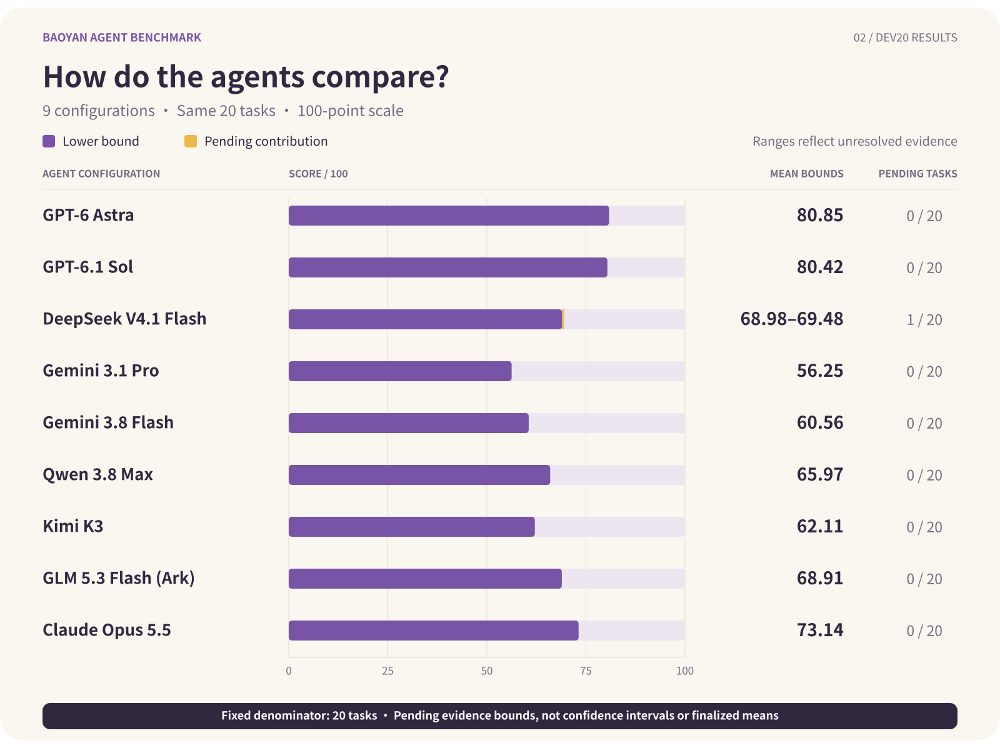
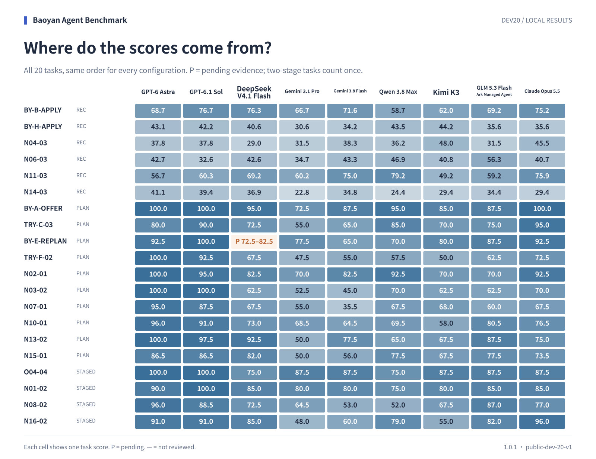

# Dev20 results

**Research-institute tier correction:** Owner-approved application of the frozen research-institute exception removes the unsupported UCAS downgrade in Claude TRY-F-02. R10-08 receives 5/5; the task scores 72.5 and the Dev20 mean is 73.14, with no Claude items pending. Prior qualification and department adjudications are retained; all other 179 answer rows are unchanged. Original reviews remain preserved; no new model calls were made.

[简体中文](README.zh-CN.md)

Updated: 2026-10-10T01:17:52+08:00

This report includes 9 configurations; 9 have completed all 20 reviews. These are preliminary local development-set results.

Bounds cover the fixed 20 tasks using the possible scores of pending items. They are not confidence intervals or finalized means. A complete mean requires scores for all tasks.

**Score verification scope:** This release includes answers, execution records, and preliminary results. The complete item-level judgments and offline score verification package are not currently public, so the public materials alone do not support independent recomputation of all scores. The verification records on this page document recomputation performed locally by the organizer.

| Model | Dev20 mean bounds | Reviewed | Scored | Pending tasks |
| --- | ---: | ---: | ---: | ---: |
| GPT-6 Astra | 80.85 | 20/20 | 20/20 | 0 |
| GPT-6.1 Sol | 80.42 | 20/20 | 20/20 | 0 |
| DeepSeek V4.1 Flash | 68.98–69.48 | 20/20 | 19/20 | 1 |
| Gemini 3.1 Pro | 56.25 | 20/20 | 20/20 | 0 |
| Gemini 3.8 Flash | 60.56 | 20/20 | 20/20 | 0 |
| Qwen 3.8 Max | 65.97 | 20/20 | 20/20 | 0 |
| Kimi K3 | 62.11 | 20/20 | 20/20 | 0 |
| GLM 5.3 Flash (Ark) | 68.91 | 20/20 | 20/20 | 0 |
| Claude Opus 5.5 | 73.14 | 20/20 | 20/20 | 0 |

Execution snapshot: Qwen 3.8 Max has 20/20 completed answers and 20/20 reviews. 6 answers used new sessions with prior records and an extended budget after timeouts; these are supplemental executions, not native session resumes. 6 of those answers have been reviewed. 4 were verified as delivered without restorable session checkpoints. Per-task execution modes, original failures, and recovery provenance are recorded below.

[Execution records and answer fingerprints](execution-progress.json)

GLM 5.3 Flash (Ark): 20/20 tasks have complete answers and 0 executions failed in this snapshot. Failed tasks are not assigned zero; a complete mean requires all 20 numeric scores.

GLM configuration: GLM 5.3 Flash (Volcengine Managed Agent), model `glm-5-3-flash-260828`, via arkcli 1.0.37. This is not a Doubao model. Cloud isolation has not been independently audited.



## Results by task type

| Model | Recommendations (6) | Planning & decisions (10) | Two-stage tasks (4) |
| --- | ---: | ---: | ---: |
| GPT-6 Astra | 48.34 | 95.00 | 94.25 |
| GPT-6.1 Sol | 48.16 | 94.00 | 94.88 |
| DeepSeek V4.1 Flash | 49.11 | 76.75–77.75 | 79.38 |
| Gemini 3.1 Pro | 41.08 | 59.85 | 70.00 |
| Gemini 3.8 Flash | 49.53 | 63.35 | 70.12 |
| Qwen 3.8 Max | 48.16 | 74.95 | 70.25 |
| Kimi K3 | 45.61 | 67.85 | 72.50 |
| GLM 5.3 Flash (Ark) | 47.71 | 75.05 | 85.38 |
| Claude Opus 5.5 | 50.40 | 81.50 | 86.38 |

## Per-task scores



[View pending items](pending-review.md)

<details>
<summary>Review setup and reproduction</summary>

- Selection: public-dev-20-v1. All 20 tasks have equal weight; two-stage tasks receive one score.
- Reviewer: Codex CLI 0.162.0, ChatGPT subscription, gpt-6.1-sol / high / live web search. A single reviewer may introduce model-family bias.
- Recomputed and verified 180 reviews; see [verification.json](verification.json).
- Client, authentication, and tools are recorded in [results.json](results.json). Kimi includes archived answer-recovery and review-timeout recovery records; Qwen BY-H-APPLY also required a separate review after timeout using the same inputs and configuration.

Generate a new report (requires the unpublished local review materials):

```sh
python3 scripts/apply_ucas_tier_adjudication.py --base experiments/subset20-results-nine-qualification-20261010 --out experiments/subset20-results-ucas-NEW --local reviews/subset20-ucas-NEW --erratum release/errata/ucas-NEW
```

Add `--png --font /path/to/font.ttc` to generate PNGs.

</details>

[Task data](scores.csv) · [Full results](results.json) · [Verification](verification.json) · [Checksums](checksums.json)

[Claude evaluation (Chinese)](claude-evaluation.zh-CN.md) · [Tier adjudication](../../release/errata/ucas-tier-20261010/decision.json)
