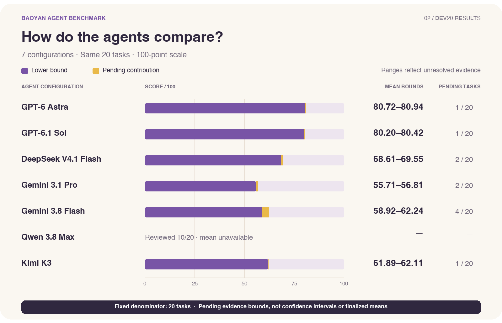
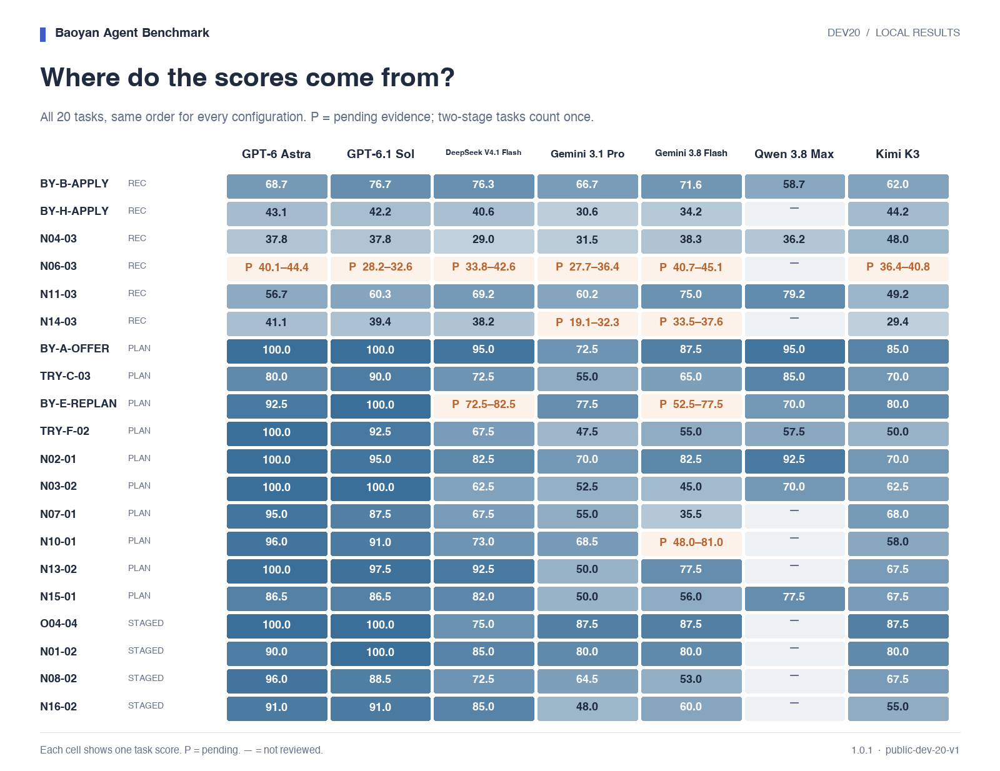

# 首批20题评测结果

[English](README.md)

更新时间：2026-10-09T23:05:17+08:00

本报告包含7个配置，其中6个已完成20题评审。以下为本地开发集初评结果。

分数范围按固定20题和待核项的可得分上下界计算，不是置信区间或已确定的均分。全部题目完成评分后才报告完整均分。

**评分复核范围：** 本次公开答卷、运行记录及初评结果。完整逐项评审材料与离线评分复核包暂未公开，因此目前无法仅凭公开材料独立重算全部评分。本页的校验记录反映组织者在本地完成的复算。

| 模型 | 20题均分范围 | 已评审 | 已评分 | 待核题 |
| --- | ---: | ---: | ---: | ---: |
| GPT-6 Astra | 80.72–80.94 | 20/20 | 19/20 | 1 |
| GPT-6.1 Sol | 80.20–80.42 | 20/20 | 19/20 | 1 |
| DeepSeek V4.1 Flash | 68.61–69.55 | 20/20 | 18/20 | 2 |
| Gemini 3.1 Pro | 55.71–56.81 | 20/20 | 18/20 | 2 |
| Gemini 3.8 Flash | 58.92–62.24 | 20/20 | 16/20 | 4 |
| Qwen 3.8 Max | — | 10/20 | 10/20 | 0 |
| Kimi K3 | 61.89–62.11 | 20/20 | 19/20 | 1 |

执行快照（2026-10-09T22:53:13+08:00）：Qwen 3.8 Max已完成16/20份答卷，已评审10/20；另有2题执行失败、2题未开始。6份新增答卷来自超时后基于既有记录开启新会话的续作，并非原生会话恢复；尚未纳入评分。4份续作答卷经核对成功交付，但可恢复会话检查点未保存。完整均分保持为空。

[执行进度与答卷指纹](execution-progress.json)



## 按题型比较

| 模型 | 择校推荐（6题） | 规划与决策（10题） | 两阶段任务（4题） |
| --- | ---: | ---: | ---: |
| GPT-6 Astra | 47.90–48.63 | 95.00 | 94.25 |
| GPT-6.1 Sol | 47.43–48.16 | 94.00 | 94.88 |
| DeepSeek V4.1 Flash | 47.86–49.32 | 76.75–77.75 | 79.38 |
| Gemini 3.1 Pro | 39.29–42.96 | 59.85 | 70.00 |
| Gemini 3.8 Flash | 48.89–50.31 | 60.45–66.25 | 70.12 |
| Qwen 3.8 Max | — | — | — |
| Kimi K3 | 44.88–45.61 | 67.85 | 72.50 |

## 逐题分数



[查看待核项](pending-review.md)

## 评审进度

| 模型 | 已收答卷 | 已评审 |
| --- | ---: | ---: |
| Qwen 3.8 Max | 16/20 | 10/20 |

<details>
<summary>评审设置与复现</summary>

- 题集：public-dev-20-v1。20题等权，两阶段题合并计分。
- 评审器：Codex CLI 0.162.0，ChatGPT订阅，gpt-6.1-sol / high / live web search。采用单一评审模型，可能存在同模型家族偏差。
- 已校验并复算130份评审记录，详情见 [verification.json](verification.json)。
- 各配置的客户端、认证和工具见 [results.json](results.json)。Kimi包含已留档的答卷恢复及评审超时补跑记录。

生成新报告（需要未公开的本地评审材料）：

```sh
python3 scripts/export_review_results.py \
  --review-dir reviews/subset20-preview-20261009-194705 \
  --cohort config/selections/public-dev20-cohort-seven-20261009.json \
  --execution-progress release/publication/dev20-qwen-execution-progress-20261009.json \
  --out experiments/subset20-results-YYYYMMDD-HHMMSS
```

可添加 `--png --font /path/to/font.ttc` 生成PNG。

</details>

[逐题数据](scores.csv) · [完整结果](results.json) · [校验记录](verification.json) · [文件校验值](checksums.json)
